<p align="center">
  <picture>
    <source media="(prefers-color-scheme: dark)" srcset="docs/brand/logo-dark.svg">
    
  </picture>
</p>

<p align="center"><b>Write it down. Remember.</b><br>
A calm, private, offline-first notes app for everything worth remembering.</p>

<p align="center">"The faintest ink is more powerful than the strongest memory"</p>


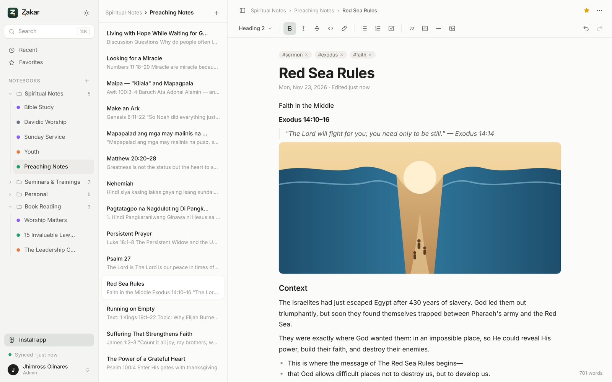

*Zakar* (זָכַר) is Hebrew for **“to remember”**. The word for “memorial” in Exodus 17:14 (*zikkaron*) comes from the same root. Zakar keeps your notes on your device so they open instantly and work offline, and syncs them to your own account when you're online.

---

## Contents

- [Features at a glance](#features-at-a-glance)
- [Organize: notebook groups, notebooks and pages](#organize-notebook-groups-notebooks-and-pages)
- [Write: editor, toolbar and images](#write-editor-toolbar-and-images)
- [Focus mode and dark mode](#focus-mode-and-dark-mode)
- [Find anything: search](#find-anything-search)
- [Export a note: PDF, text or Markdown](#export-a-note-pdf-text-or-markdown)
- [Import your existing notes](#import-your-existing-notes)
- [Works offline, syncs everywhere](#works-offline-syncs-everywhere)
- [Install it like an app](#install-it-like-an-app)
- [On your phone](#on-your-phone)
- [Accounts and users](#accounts-and-users)
- [Updates, What's new and About](#updates-whats-new-and-about)
- [Keyboard shortcuts](#keyboard-shortcuts)
- [Deploy your own (GitHub + Cloudflare)](#deploy-your-own-github--cloudflare)
- [Run locally](#run-locally)
- [How it works](#how-it-works)
- [Brand](#brand)
- [Roadmap](#roadmap)

---

## Features at a glance

Zakar is a general-purpose notes app: ideas, work and meeting notes, class notes, books, plans, journals and lists. (The screenshots show book notes on *The Leadership Challenge* as sample content.)

| Feature | What it does |
|---|---|
| **Organize** | Notebook groups (folders), notebooks, pages and subpages, with drag and drop and breadcrumbs |
| **Write** | Clean editor with a formatting toolbar, `/` commands, checklists, quotes, code, links, tags |
| **Images** | Embed images from a link, with a live preview; no uploads or storage needed |
| **Focus** | Hide the sidebar for distraction-free writing; light and dark mode |
| **Find** | ⌘K / Ctrl+K search across titles, text and `#tags`, plus quick actions |
| **Export** | Any note as PDF, plain text (.txt) or Markdown; everything as a .zip |
| **Import** | Markdown files, whole folders or a .zip (e.g. an Obsidian vault), with a preview first |
| **Offline** | Notes live on your device; changes sync when you're back online, and nothing is ever lost in a conflict |
| **Install** | Add it to your Home Screen, Dock or desktop like a native app |
| **Private** | Your own Cloudflare account, built-in sign-in, and an admin who manages users; every user's notes are private |
| **Always current** | Updates itself after each release, then shows a short *What's new* note; full changelog and *About* under your name |
| **Free** | Runs on Cloudflare's free tier (Pages + D1) |

---

## Organize: notebook groups, notebooks and pages

Zakar's structure is simple: **groups › notebooks › pages › subpages**.

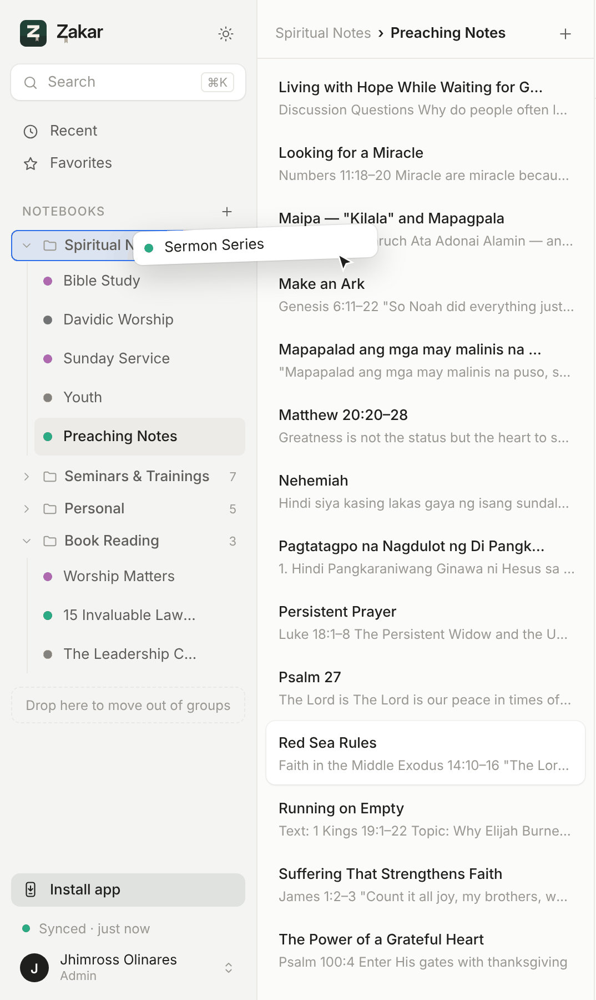

- **Notebook groups** are folders in the sidebar (for example *Work*, *Personal*, *Book Reading*). Click a group to fold or unfold it.
- **Drag and drop**:
  - drop a notebook **onto** a group to put it inside;
  - drop it **between** items (a blue line shows where) to reorder;
  - drag a **group** to move it with all its notebooks;
  - drop on **“Drop here to move out of groups”** to take a notebook out.
- **Pages and subpages**: drag a page onto another to make it a subpage (up to 2 levels), or use the page's **⋯** menu → *Add subpage*, *Indent*, *Outdent*, *Move to notebook…*
- **Breadcrumbs** at the top of the page list and the note show where you are, e.g. *Work › Clients › Kickoff call*.
- **Colors**: give notebooks and groups a color from their **⋯** menu.
- **Favorites and Recent** in the sidebar; **Trash** (with restore) is in the account menu.
- On phones, use the **⋯** menus instead of dragging (*Move to group*, *Remove from group*).

<br clear="right">

---

## Write: editor, toolbar and images

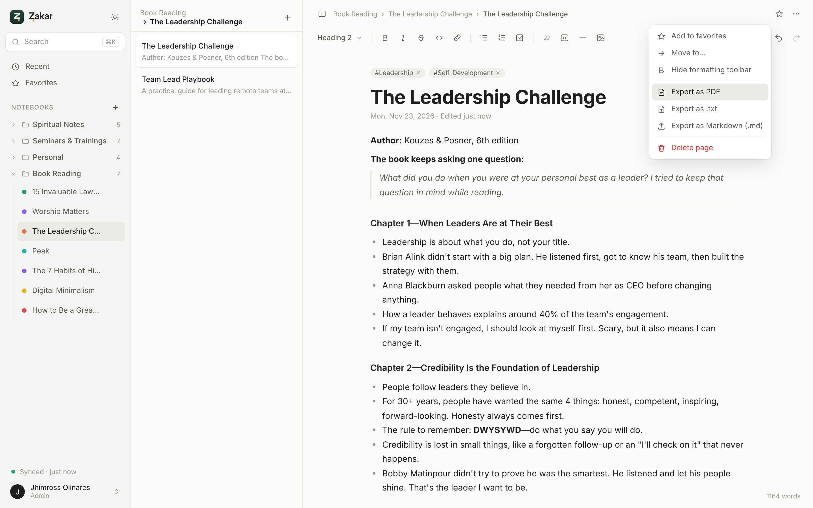

- **Formatting toolbar** under the note's title bar:
  text style (Text, Heading 1–3) · **bold** · *italic* · ~~strikethrough~~ · `code` · link · bullet list · numbered list · checklist · quote · code block · divider · **image** · undo/redo.
  Active styles are highlighted. Hide it from the note's **⋯** menu if you prefer a bare page.
- **`/` commands**: type `/` anywhere for the same blocks (e.g. `/heading`, `/todo`, `/quote`, `/image`).
- **Markdown shortcuts** work as you type: `# ` heading, `- ` list, `1. ` numbered list, `[ ] ` checklist, `> ` quote, ` ``` ` code block, `---` divider.
- **Tags**: hover above the title and click **Add tag**. Tags show as chips and are searchable with `#tag`.
- **Autosave**: every change is saved on your device immediately and synced shortly after you stop typing.

### Images from a link

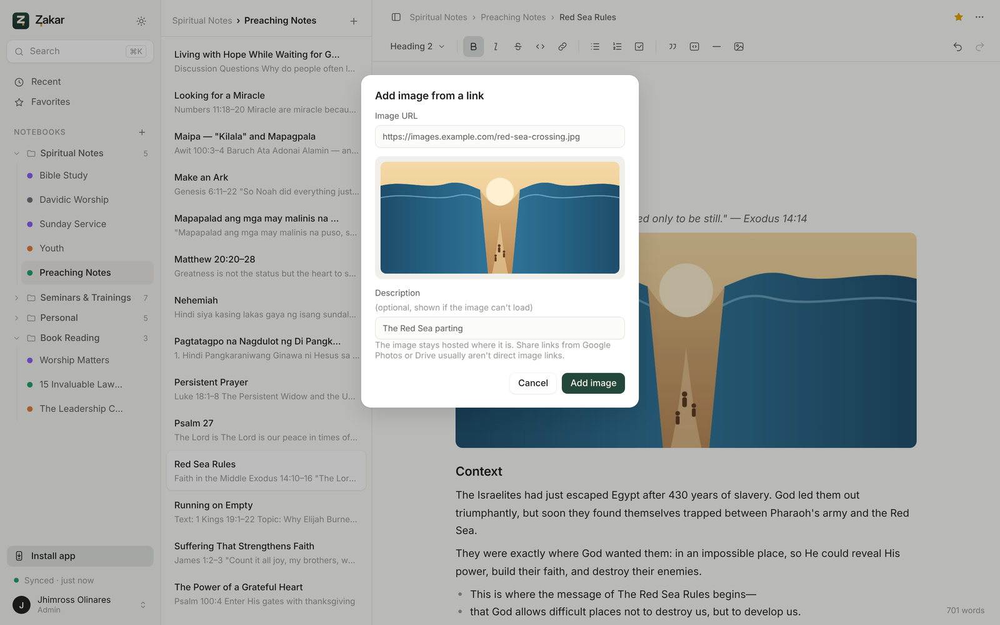

Images are **embedded by URL**: the image stays hosted where it is (your website, an image host, a CDN), so there's nothing to upload and no storage to pay for.

- Click the **image** button in the toolbar, type `/image`, or simply **paste a direct image link** on its own.
- The dialog shows a **live preview** and won't add a link that isn't an image.
- Add an optional **description** (shown if the image can't load).
- **Double-click** an image to change its link or description; select it and press Delete to remove it.
- Images you've viewed are **cached for offline use**.

> **Tip:** right-click an image on a website → **Copy Image Address**. Share links from Google Photos/Drive are web pages, not images, so they usually won't work.

---

## Focus mode and dark mode

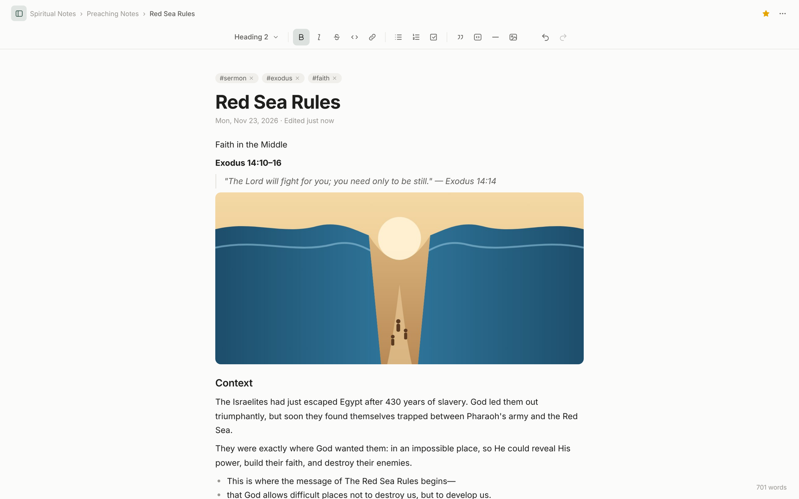

- **Focus mode** (desktop): click the sidebar icon at the left of the note's title bar, or press **Ctrl + \\** (**⌘ + \\** on Mac). The sidebar and page list slide away so only your writing remains. Press it again to bring them back. Zakar remembers your choice.
- **Light, dark or system theme**: the sun/moon icon next to the logo cycles through them.

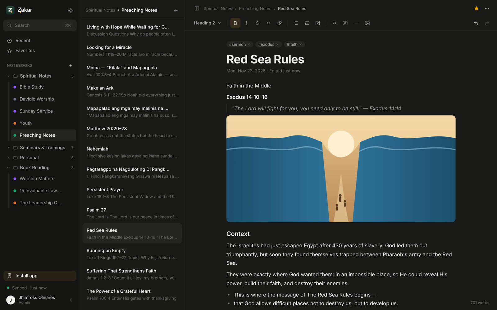

---

## Find anything: search

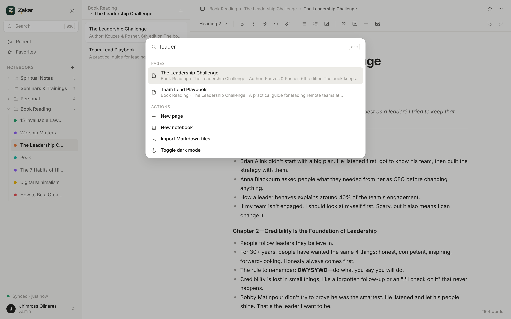

Press **⌘K** (Mac) or **Ctrl+K** (Windows) anywhere, or click **Search** in the sidebar.

- Searches **titles, note text and tags** instantly, even offline, with typo tolerance.
- Start with `#` to search by tag (e.g. `#meeting`).
- Quick actions: *New page*, *New notebook*, *Import Markdown files*, *Export all notes*, *Toggle dark mode*, *Install app*.
- Use ↑ ↓ and Enter to pick a result, Esc to close.

---

## Export a note: PDF, text or Markdown

Open a note's **⋯** menu (top right):

| Option | What you get |
|---|---|
| **Export as PDF** | A clean, print-ready layout of the note (title, notebook, date, tags and content, including images). Your browser's print window opens; choose **Save as PDF**. On iPhone/iPad: *Print* → tap **Share** in the preview → *Save to Files*. |
| **Export as .txt** | Plain text that stays readable: headings, bullets (•), numbered lists, checklists (`[ ]` / `[x]`), quotes and image links. |
| **Export as Markdown (.md)** | The note with its title, tags and dates in front matter, ready for other apps (or to re-import). |

<p align="center">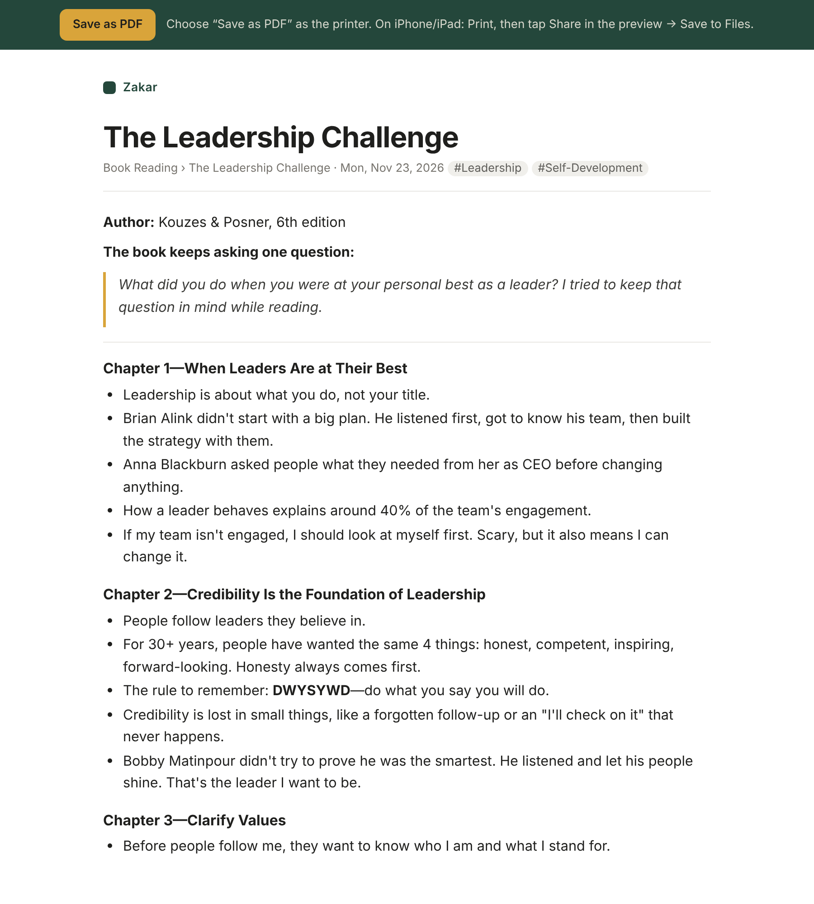</p>

**Export everything**: account menu → **Export all notes (.zip)** downloads all notebooks as Markdown files in folders, so you're never locked in.

---

## Import your existing notes

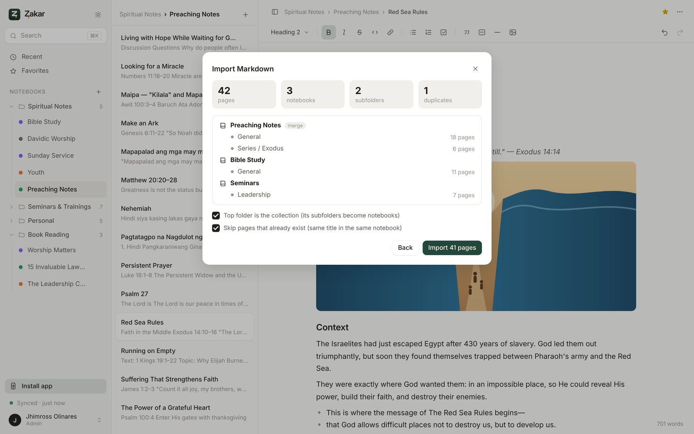

Account menu → **Import .md files**, then drop in **files**, a **whole folder** or a **.zip** (an Obsidian vault works too). You'll see a **preview** before anything is saved.

| On disk | In Zakar |
|---|---|
| `Vault/Work Notes/` | Notebook **Work Notes** |
| `Vault/Work Notes/Kickoff.md` | Page **Kickoff** |
| `Meeting.md` + a `Meeting/` folder | Files in the folder become **subpages** of *Meeting* |
| Deeper folders, e.g. `Work Notes/Clients/…` | A parent page **Clients** with its notes inside |
| Loose files (no folder) | A notebook you choose (default *Imported*) |

- Keeps front matter **title**, **tags**, **created** and **updated**, plus inline `#tags`.
- Merges into notebooks that already exist (same name) and can **skip duplicates** (same title).
- Images linked with a web address (`https://…`) show up automatically.

---

## Works offline, syncs everywhere

- Your notes are stored **on your device** (IndexedDB), so the app opens instantly and keeps working **without internet**.
- A small status at the bottom of the sidebar shows **Synced · just now**, **Offline · 3 changes to sync**, or **Syncing…**. While offline, a banner above the note says your changes will sync later.
- When you're back online, changes go up and changes from your other devices come down: on open, when you reconnect, every minute, and a couple of seconds after you stop typing.
- **Conflict-safe**: if the same page was edited on two devices while offline, Zakar keeps **both** versions; one is saved as *“(conflict copy)”*. Nothing is silently overwritten.
- Deleted pages go to **Trash** on every device and can be restored.

---

## Install it like an app

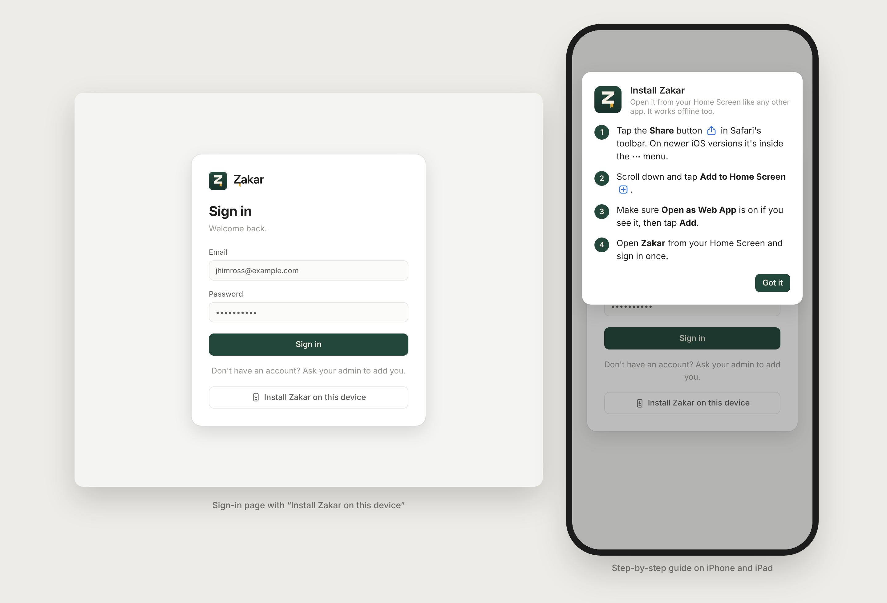

An **Install** button appears on the sign-in page and at the bottom of the sidebar (and in ⌘K):

- **Chrome, Edge, Android**: opens the browser's install prompt.
- **iPhone and iPad**: shows step-by-step **Add to Home Screen** instructions.
- **Safari on Mac**: shows the **File → Add to Dock** steps.
- **Already installed?** The button disappears when you open Zakar as an app. *(Safari can't tell whether you've added it to your Home Screen, so the button still shows in a normal Safari tab.)*

> **iPhone/iPad:** use the installed app rather than a Safari tab. Safari may clear offline data for sites you haven't installed.

---

## On your phone

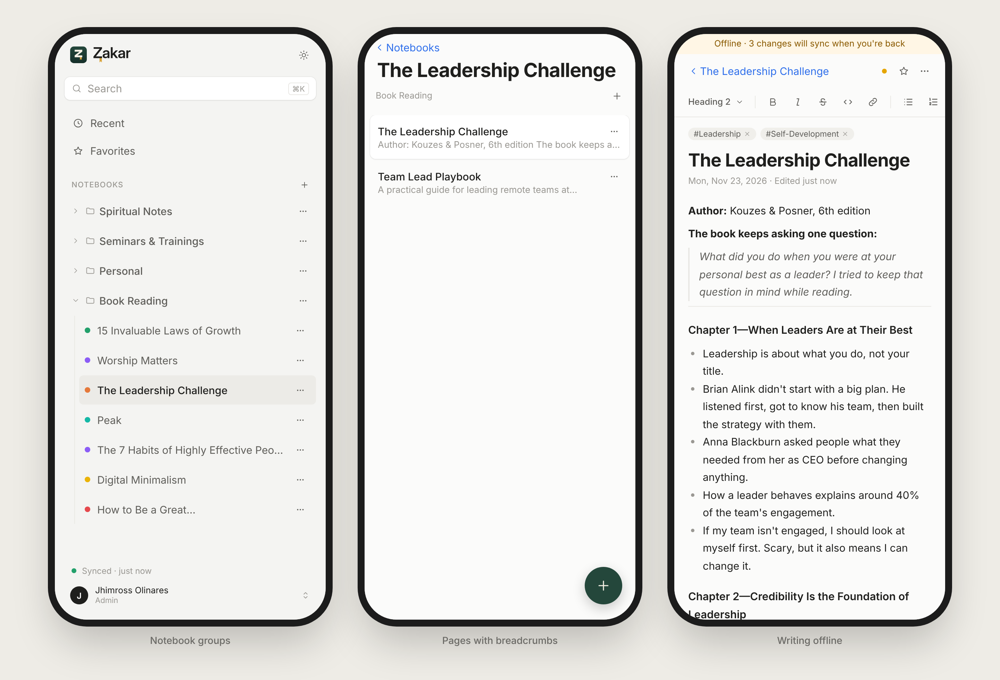

The layout adapts to small screens: **notebooks → pages → note**, with back buttons, a big **+** button for new pages, a swipeable formatting toolbar, and an offline banner when you lose signal.

The phone's **Back button** (Android) and **swipe from the left edge** (iPhone/iPad) work inside the app: they close an open menu or dialog first, then go note → pages → notebooks. Only on the first screen does Back leave the app. In a desktop browser, Back closes open dialogs.

---

## Accounts and users

<table>
<tr>
<td width="50%">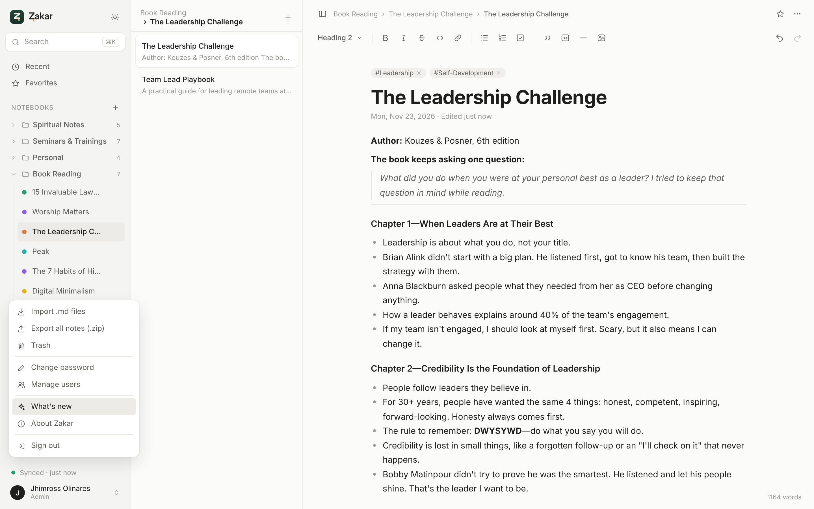</td>
<td width="50%">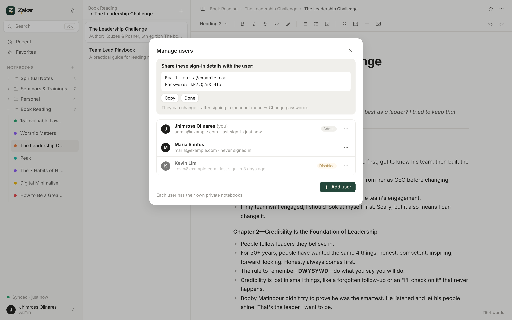</td>
</tr>
</table>

- **Sign in** with email and password. The **first person** to open a new deployment creates the **admin** account; nobody can do that step again afterwards.
- **Account menu** (click your name, bottom left): *Import .md files*, *Export all notes*, *Trash*, *Change password*, *Manage users* (admins), *What's new*, *About Zakar*, *Sign out*.
- **Manage users** (admins): add people with a generated temporary password (with a **Copy** button to share it), reset passwords, disable or re-enable accounts, make other admins, or delete users and their notes. You can't lock yourself out by accident.
- **Every user's notes are private.**
- **Security**: passwords are hashed (PBKDF2-SHA256); sessions use secure, HTTP-only cookies and last 30 days, renewed while you use the app; 10 wrong passwords lock that email for 15 minutes; cross-site requests are rejected.
- **Signing out** removes that user's notes from the device (they come back when you sign in again).

---

## Updates, What's new and About

<table>
<tr>
<td width="50%">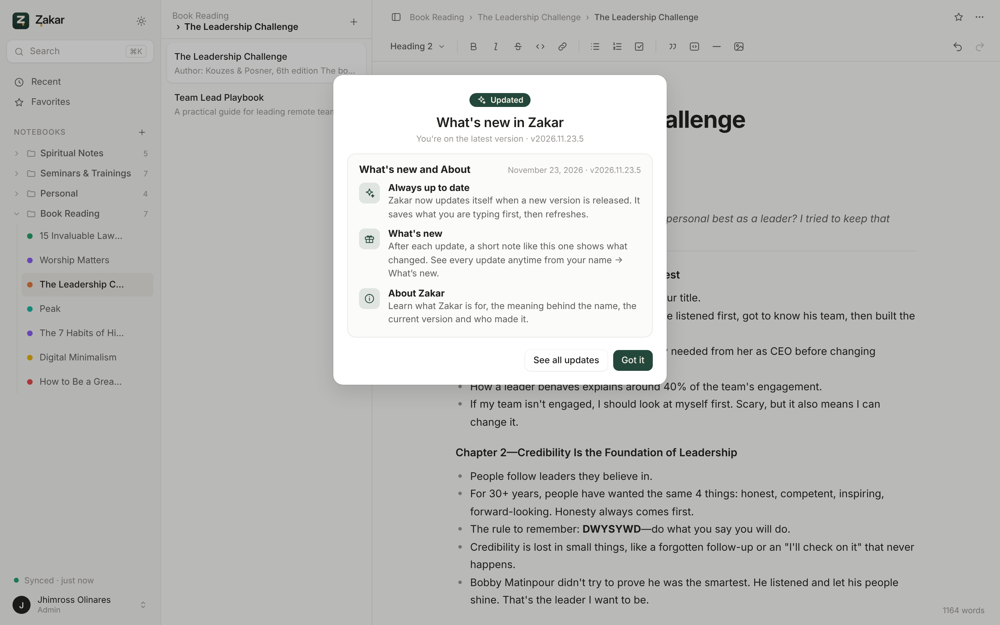</td>
<td width="50%">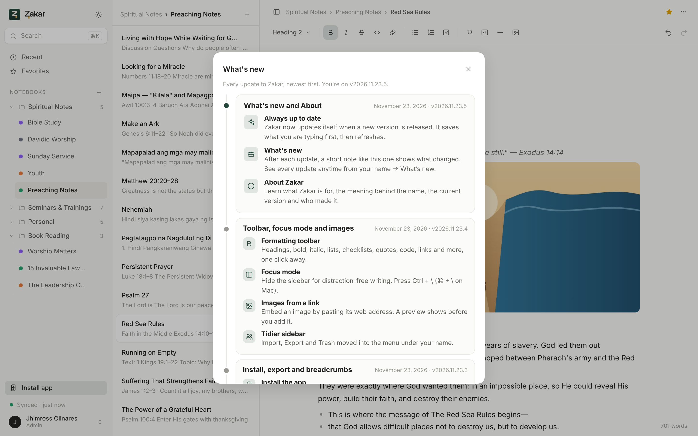</td>
</tr>
</table>

**Automatic updates.** When you deploy a new version, every open copy of Zakar (browser tab or installed app) picks it up on its own:

- It checks for a new version when the app opens, when you come back to it, every 30 minutes, and when you reconnect to the internet.
- When one is found, a small *“Updating Zakar to the latest version…”* note appears. It waits until you pause typing, saves what you were writing, then refreshes. Unsynced notes are safe either way: they live on the device.
- You can also check by hand: your name → **About Zakar** → **Check for updates**.

**What's new.** After an update, a pop-up shows what changed in the release (or each release you missed). It appears once per release; brand-new users don't see old notes. The full history is always under your name → **What's new**.

**About.** Your name → **About Zakar** shows the version and release date, what Zakar is for, the meaning behind the name, and the developer.

<p align="center">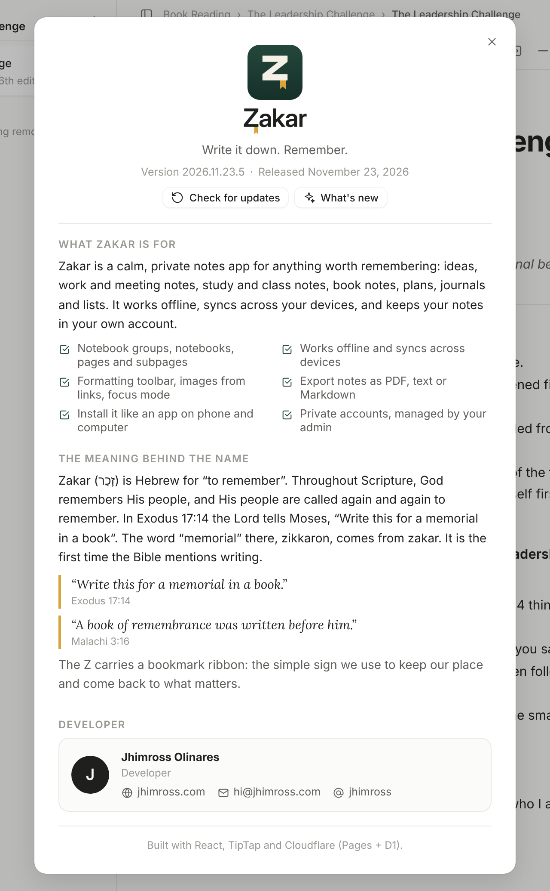</p>

### Publishing a release

Versions are dates: `YYYY.MM.DD`, with `.1`, `.2`… for more releases on the same day (e.g. `2026.11.23`, `2026.11.23.1`).

1. Open `src/changelog.ts` and add a new entry **at the top** of `CHANGELOG`:

   ```ts
   {
     version: '2026.12.01',
     date: '2026-12-01',
     title: 'Presentation mode',
     items: [
       { icon: 'focus', title: 'Presentation mode', text: 'Full-screen, large text, and the screen stays awake.' },
     ],
   },
   ```

   `icon` is any name from `src/components/Icon.tsx`. The top entry becomes the app version shown in *About*.
2. Commit and push (or `npm run build && npx wrangler pages deploy dist`). That's it: open copies update themselves and show the note.

To change the developer details or the About text, edit `src/about.ts`.

---

## Keyboard shortcuts

| Action | Mac | Windows / Linux |
|---|---|---|
| Search and quick actions | ⌘ K | Ctrl K |
| Focus mode (hide sidebar) | ⌘ \ | Ctrl \ |
| Bold / Italic | ⌘ B / ⌘ I | Ctrl B / Ctrl I |
| Undo / Redo | ⌘ Z / ⌘ ⇧ Z | Ctrl Z / Ctrl Shift Z |
| Insert block | `/` | `/` |
| From title to note | Enter or ↓ | Enter or ↓ |

---

## Deploy your own (GitHub + Cloudflare)

Everything runs on Cloudflare's free tier: **Pages** hosts the app and its API, **D1** stores your notes.

### 1. Put the code on GitHub

Create a **private** repository and push this folder (or upload the files on github.com, including hidden files like `.gitignore`).

```bash
git init && git add . && git commit -m "Zakar"
git branch -M main
git remote add origin https://github.com/<you>/<repo>.git
git push -u origin main
```

### 2. Create the database

Cloudflare dashboard → **Storage & Databases → D1 → Create database** (e.g. `mynotes`). Copy its **Database ID** into `wrangler.toml`:

```toml
name = "mynotes"
pages_build_output_dir = "dist"
compatibility_date = "2025-06-01"

[[d1_databases]]
binding = "DB"
database_name = "mynotes"
database_id = "<your database id>"

[vars]
NODE_VERSION = "22"   # Cloudflare's default Node is too old for the build
```

The app creates its tables automatically on first use. If that ever fails (the site says *“Database setup failed”*), run the SQL in [Manual database setup](#manual-database-setup) once.

### 3. Create the Pages project

**Workers & Pages → Create → Pages** tab (or *“Looking to deploy Pages? Get started”*) **→ Connect to Git**, pick the repo, and set:

- Framework preset: **None**
- Build command: `npm run build`
- Build output directory: `dist`

> If you see a **“Deploy command”** field, you're creating a *Worker* instead of a *Pages* project. Go back and choose Pages.

Every push to `main` redeploys automatically.

### 4. Create your admin account

Open your new site **right away** and fill in **Create your admin account**. Then add others via **account menu → Manage users**.

### 5. Install it

Open the site on each device and use the **Install** button (see [Install it like an app](#install-it-like-an-app)).

### Deploy from the command line (optional)

Requires Node 22+.

```bash
npm install
npm run build
npx wrangler login
npx wrangler pages deploy dist --project-name <your-pages-project>
```

### Troubleshooting

| Problem | Fix |
|---|---|
| Build log shows `nodejs@18` and errors | Make sure `NODE_VERSION = "22"` is under `[vars]` in `wrangler.toml` (dashboard build variables are ignored when `wrangler.toml` exists). |
| `ERESOLVE could not resolve` during install | Dependency versions disagree; update `package.json`, or add a `.npmrc` file containing `legacy-peer-deps=true`. |
| `Missing entry-point to Worker script` | The project was created as a Worker. Create a **Pages** project instead. |
| Sign-in page says **“Can't reach the server”** | Open `/api/health` on your site. *“No D1 database is connected”* → check the D1 binding named `DB` (Pages project → Settings → Bindings) and the ID in `wrangler.toml`. *“Database setup failed: …”* → run the [manual database setup](#manual-database-setup). |
| Someone else created the admin account first | In the D1 console run `DELETE FROM users;` then `DELETE FROM sessions;` (one at a time), and reload the site. |
| The D1 console only runs one line | It runs the statement your cursor is on. Click each line and press **Run**, in order. |

### Manual database setup

<details>
<summary>SQL for the D1 console (run one line at a time, in order)</summary>

```sql
CREATE TABLE IF NOT EXISTS meta (k TEXT PRIMARY KEY, v INTEGER NOT NULL);
INSERT OR IGNORE INTO meta (k, v) VALUES ('seq', 0);
CREATE TABLE IF NOT EXISTS notebooks (id TEXT PRIMARY KEY, name TEXT NOT NULL DEFAULT '', color TEXT, icon TEXT, sort_key TEXT NOT NULL DEFAULT 'a0', created_at INTEGER, updated_at INTEGER, deleted_at INTEGER, seq INTEGER NOT NULL, user_id TEXT, group_id TEXT);
CREATE TABLE IF NOT EXISTS sections (id TEXT PRIMARY KEY, notebook_id TEXT NOT NULL, parent_id TEXT, name TEXT NOT NULL DEFAULT '', color TEXT, sort_key TEXT NOT NULL DEFAULT 'a0', created_at INTEGER, updated_at INTEGER, deleted_at INTEGER, seq INTEGER NOT NULL, user_id TEXT);
CREATE TABLE IF NOT EXISTS pages (id TEXT PRIMARY KEY, section_id TEXT NOT NULL, parent_id TEXT, title TEXT NOT NULL DEFAULT '', content TEXT NOT NULL DEFAULT '', tags TEXT NOT NULL DEFAULT '[]', favorite INTEGER NOT NULL DEFAULT 0, purged INTEGER NOT NULL DEFAULT 0, sort_key TEXT NOT NULL DEFAULT 'a0', created_at INTEGER, updated_at INTEGER, deleted_at INTEGER, seq INTEGER NOT NULL, user_id TEXT);
CREATE TABLE IF NOT EXISTS notebook_groups (id TEXT PRIMARY KEY, name TEXT NOT NULL DEFAULT '', color TEXT, sort_key TEXT NOT NULL DEFAULT 'a0', created_at INTEGER, updated_at INTEGER, deleted_at INTEGER, seq INTEGER NOT NULL, user_id TEXT);
CREATE TABLE IF NOT EXISTS users (id TEXT PRIMARY KEY, email TEXT NOT NULL UNIQUE COLLATE NOCASE, name TEXT NOT NULL DEFAULT '', password_hash TEXT NOT NULL, is_admin INTEGER NOT NULL DEFAULT 0, disabled INTEGER NOT NULL DEFAULT 0, created_at INTEGER NOT NULL, last_login_at INTEGER);
CREATE TABLE IF NOT EXISTS sessions (id TEXT PRIMARY KEY, user_id TEXT NOT NULL, created_at INTEGER NOT NULL, expires_at INTEGER NOT NULL, user_agent TEXT);
CREATE TABLE IF NOT EXISTS login_attempts (k TEXT PRIMARY KEY, count INTEGER NOT NULL, window_start INTEGER NOT NULL);
CREATE INDEX IF NOT EXISTS idx_sessions_user ON sessions(user_id);
CREATE INDEX IF NOT EXISTS idx_notebook_groups_user_seq ON notebook_groups(user_id, seq);
CREATE INDEX IF NOT EXISTS idx_notebooks_user_seq ON notebooks(user_id, seq);
CREATE INDEX IF NOT EXISTS idx_sections_user_seq ON sections(user_id, seq);
CREATE INDEX IF NOT EXISTS idx_pages_user_seq ON pages(user_id, seq);
INSERT INTO meta (k, v) VALUES ('schema', 3) ON CONFLICT(k) DO UPDATE SET v = excluded.v;
```

This is for a **new, empty** database. If your tables already exist from an older version, add the missing columns instead (`ALTER TABLE notebooks ADD COLUMN user_id TEXT;` etc.); a *“duplicate column name”* error just means it's already there.

</details>

### Free tier

D1's free plan includes 5 GB of storage, 5 million rows read and 100,000 rows written per day. Zakar batches edits (it syncs a couple of seconds after you stop typing), so normal use stays far below that. Images are embedded by link, so they use no storage.

---

## Run locally

Requires Node 22+.

```bash
npm install
npm run build && npm run pages:dev    # http://localhost:8788 – a local D1 database is created automatically
```

On first visit, create a local admin account. For hot reload while editing UI code, keep `npm run pages:dev` running and run `npm run dev` in a second terminal (Vite proxies `/api` to port 8788).

```bash
npm test         # sync, accounts, import and export logic
npm run typecheck
```

---

## How it works

**Stack:** React + TypeScript + Vite · TipTap editor (stores Markdown) · Dexie (IndexedDB) · Workbox service worker (PWA) · Cloudflare Pages Functions · Cloudflare D1 (SQLite).

```
functions/api/        Cloudflare Pages Functions (the API)
  _middleware.ts      Creates tables if needed; requires a signed-in user
  auth/[[path]].ts    /api/auth/me | setup | login | logout | password
  admin/[[path]].ts   /api/admin/users (admins only)
  sync.ts             POST /api/sync – push local changes, pull remote ones
  health.ts           GET /api/health
shared/               Code shared by browser and server (schema, sync, accounts)
src/
  data/               IndexedDB, write actions, sync client, sign-in state
  components/         UI (sidebar, page list, editor, toolbar, dialogs…)
  import/             .md import and export
  lib/                text helpers, install prompt, auto-update, Back button handling
  changelog.ts        Release notes (newest first); the top entry is the app version
  about.ts            Text for the About dialog
docs/                 Screenshots and brand files used by this README
tests/                Node tests for sync, accounts, import and export
```

**Sync, in short**

- The device's database is the source of truth; the UI never waits on the network.
- Each edit updates the local row and adds an entry to an **outbox**.
- `POST /api/sync` sends up to 20 changes and receives everything changed since the device's last cursor. Every server row carries an increasing `seq` number and belongs to one user.
- A change based on an older version is a **conflict**: page text is never lost (a *conflict copy* is created); for titles, moves and other details the newest edit wins.
- Deletes are kept as tombstones so they reach every device.

Internally each notebook still has one hidden “section” that holds its pages; older data or imports with several sections are folded into parent pages automatically.

---

## Brand

<table><tr>
<td width="110"></td>
<td><b>Zakar</b> (זָכַר), “to remember”. The <b>Z</b> carries a bookmark ribbon, the simple sign we use to keep our place and come back to what matters.</td>
</tr></table>

Colors: **Cedar** `#24473B` · **Deep cedar** `#16302A` · **Gold ribbon** `#D9A43A` · **Parchment** `#F6F1E6` · **Ink** `#1F1F1D` · **Clay** `#B4532F`
Type: **Inter Display** (logo and headings) · **Inter** (app) · **Lora Italic** (verses)
Taglines: *Write it down. Remember.* · *Isulat. Hinumdumi.*

---

## Roadmap

Ideas for what's next:

- **Presentation mode**: full-screen, large text, screen stays awake, optional timer
- **Templates** for notes you write often (meetings, studies, journals)
- **Read-only share links** for a note
- **Links between pages** (`[[wikilinks]]`) and backlinks
- **Page history** to restore older versions
- **File uploads** via Cloudflare R2 (images are already supported by link)

---

## License

The code is released under the [MIT License](LICENSE): you're free to use, change and self-host it.

The **Zakar name, logo and app icons** (`docs/brand/`, `public/icons/`, `scripts/icons.b64.json`) are not covered by the license. If you deploy your own copy, please give it your own name and icon (set them in `vite.config.ts`, `index.html` and `src/components/Brand.tsx`).
